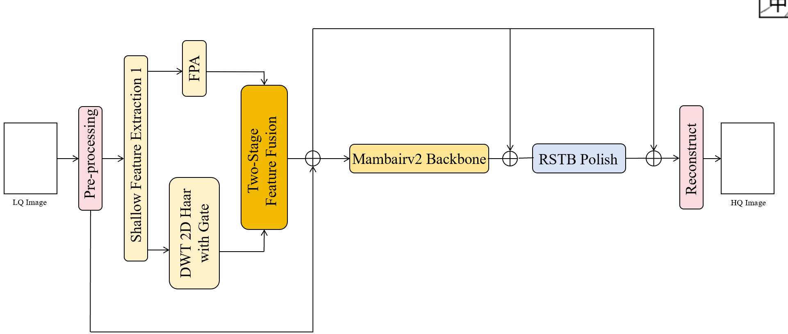

# AetherNet: Image Restoration with Design Patterns

[](https://pytorch.org)
[](https://python.org)
[](LICENSE)

<p align="center">
  
</p>

**AetherNet** 是一个基于设计模式构建的图像恢复研究框架，整合了多种先进的图像超分辨率、去噪和压缩伪影去除模型。项目采用工厂模式、策略模式、模板方法和注册表模式，提供统一且可扩展的训练与测试接口。

> **研究状态**: 开发中

## 特性

- **设计模式驱动**: 工厂、策略、模板方法、注册表模式，代码清晰易扩展
- **即插即用模型**: SwinIR、MambaIRv2、CWFNet、EDSR、ELAN、SRFormer
- **配置驱动训练**: YAML配置 + 命令行参数，灵活控制实验
- **多任务支持**: 经典SR、真实世界去噪、JPEG伪影去除

## 设计模式

### 1. 注册表模式 (Registry Pattern)

全局注册表管理模型、数据集、损失函数等组件：

```python
from core import MODEL_REGISTRY

@MODEL_REGISTRY.register()
class MyModel(nn.Module):
    ...

# 获取已注册模型
model_cls = MODEL_REGISTRY.get('MyModel')
```

### 2. 工厂模式 (Factory Pattern)

统一的模型创建接口：

```python
from core import ModelFactory

# 通过配置创建
config = {'model_name': 'SwinIR', 'upscale': 4, 'embed_dim': 180}
model = ModelFactory.create(config)

# 通过名称创建
model = ModelFactory.create_by_name('CWFNet', upscale=4)
```

### 3. 策略模式 (Strategy Pattern)

灵活的图像退化策略：

```python
from core import ClassicalSRDegradation, ColorDenoiseDegradation

# 经典SR退化（双三次下采样）
degradation = ClassicalSRDegradation(scale=4)
lr_image = degradation.apply(hr_image)

# 去噪退化（高斯噪声）
degradation = ColorDenoiseDegradation(sigma=25)
noisy_image = degradation.apply(clean_image)
```

### 4. 模板方法模式 (Template Method Pattern)

标准化的训练/测试流程：

```python
from core import BaseTrainer

class SwinIRTrainer(BaseTrainer):
    def build_model(self):
        return SwinIR(**self.config['model'])
    
    def train_step(self, batch):
        lr, hr = batch
        output = self.model(lr)
        loss = self.criterion(output, hr)
        ...
        return loss.item()

trainer = SwinIRTrainer(config)
trainer.train()
```

## 安装

### 环境要求

- Python 3.8+
- PyTorch 1.12+
- CUDA 11.0+ (推荐)

### 快速安装

```bash
git clone https://github.com/Jackksonns/AetherNet.git
cd AetherNet

# 创建虚拟环境（推荐）
conda create -n aethernet python=3.9
conda activate aethernet

# 安装PyTorch（根据CUDA版本选择）
pip install torch torchvision --index-url https://download.pytorch.org/whl/cu118

# 安装依赖
pip install -r requirements.txt

# MambaIRv2支持（可选）
pip install mamba-ssm
```

## 数据集准备

### DIV2K

```bash
# 下载DIV2K数据集
cd datasets
bash organize_div2k.sh

# 目录结构
datasets/
├── DIV2K/
│   ├── train/
│   │   ├── HR/           # 高分辨率图像
│   │   └── LR_bicubic/   # 双三次下采样图像
│   │       ├── X2/
│   │       ├── X3/
│   │       └── X4/
│   └── val/
```

### 自定义数据集

参考 [datasets/dataset.py](datasets/dataset.py) 实现自定义数据集类。

## 使用方法

### 训练

```bash
# 使用配置文件训练
python scripts/train/train.py --config configs/train_MambaIRv2_SR_x4.yml

# 训练SwinIR
python scripts/train/train_swinir.py --scale 4 --batch_size 8 --epochs 100

# 训练CWFNet
python scripts/train/train_cwfnet.py --scale 4 --use_wavelet --use_cvoca
```

### 测试

```bash
# 测试SwinIR
python scripts/test/test_swinir.py --checkpoint weights/swinir_x4.pth

# 测试CWFNet
python scripts/test/test_cwfnet.py --checkpoint weights/cwfnet_x4.pth
```

### Python API

```python
from models import SwinIR
from core import ModelFactory
import torch

# 方式1：直接导入
model = SwinIR(upscale=4, in_chans=3, img_size=64, 
               window_size=8, img_range=1., depths=[6]*6,
               embed_dim=180, num_heads=[6]*6, mlp_ratio=2,
               upsampler='pixelshuffle', resi_connection='1conv')

# 方式2：工厂创建
model = ModelFactory.create_by_name('SwinIR', upscale=4)

# 加载权重
model.load_state_dict(torch.load('weights/model.pth'))
model.eval()

# 推理
with torch.no_grad():
    sr_image = model(lr_image)
```

## 实验结果

### 经典图像超分辨率 (4×)

| 模型 | Set5 (PSNR/SSIM) | Set14 (PSNR/SSIM) | BSD100 (PSNR/SSIM) | Urban100 (PSNR/SSIM) | 参数量 |
|------|------------------|-------------------|--------------------|-----------------------|--------|
| EDSR | 32.46/0.8968 | 28.80/0.7876 | 27.71/0.7420 | 26.64/0.8033 | 43M |
| SwinIR | 32.72/0.9021 | 28.94/0.7914 | 27.83/0.7459 | 27.07/0.8164 | 12M |
| MambaIRv2 | 32.85/0.9031 | 29.05/0.7931 | 27.92/0.7481 | 27.35/0.8215 | 10M |
| CWFNet | TBD | TBD | TBD | TBD | TBD |

> 实验结果持续更新中

## 配置说明

### YAML配置文件示例

```yaml
# configs/train_swinir_x4.yml
model:
  name: SwinIR
  upscale: 4
  in_chans: 3
  img_size: 64
  window_size: 8
  embed_dim: 180
  depths: [6, 6, 6, 6, 6, 6]
  num_heads: [6, 6, 6, 6, 6, 6]
  mlp_ratio: 2
  upsampler: pixelshuffle

training:
  batch_size: 8
  epochs: 100
  lr: 1e-4
  scheduler:
    type: cosine
  
data:
  train_dir: datasets/DIV2K/train
  val_dir: datasets/DIV2K/val
  patch_size: 64
```

## 引用

如果本项目对您的研究有帮助，请引用相关工作：
waiting for updation...


## 致谢

- [SwinIR](https://github.com/JingyunLiang/SwinIR) - Swin Transformer图像恢复
- [MambaIRv2](https://github.com/csguoh/MambaIR) - 状态空间模型图像恢复
- [LKFNet](https://ieeexplore.ieee.org/document/10678583) - 大核频率增强网络
- 以及所有开源社区贡献者

---

**AetherNet** - 基于设计模式的图像恢复研究框架

*Developed by [Jackksonns](https://github.com/Jackksonns)*
