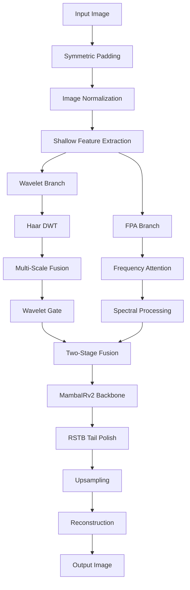

# JkNet: Robust Image Enhancement with Parallel Wavelet-Frequency Perception

[](https://pytorch.org)
[](LICENSE)
[](https://github.com/Jackksonns/AetherNet/tree/main)

**JkNet** is a state-of-the-art image enhancement network that combines wavelet analysis with modern deep learning for robust image super-resolution, denoising, and compression artifact removal. Built upon [MambaIRv2](https://arxiv.org/abs/2411.15269) with innovative parallel shallow feature extraction and enhanced by [SwinIR](https://arxiv.org/abs/2108.10257) components, JkNet achieves superior performance across multiple image restoration tasks. (Explore more of my work at [Jackksonns' GitHub](https://github.com/Jackksonns/).)

>  **Research Status**: still developing---.

## 🚀 Key Features

###  **Dual-Branch Parallel Architecture**
- **Wavelet Hint Branch**: Leverages Haar wavelet decomposition for explicit multi-resolution analysis
- **FPA Branch**: Frequency Perception Attention based on [Large Kernel Frequency-enhanced Network](https://ieeexplore.ieee.org/document/10678583) for adaptive frequency component processing
- **Intelligent Fusion**: Two-stage fusion with global gating and local mask refinement

###  **Advanced Components**
- **MambaIRv2 Backbone**: Selective state-space models for efficient long-range dependency modeling
- **SwinIR RSTB Tail**: Transformer-based refinement for enhanced reconstruction quality
- **Adaptive Normalization**: Instance normalization with learnable scaling factors

### ⚡ **Multi-Task Capability**
- **Classical Super-Resolution** (×2, ×3, ×4, ×8)
- **Real-World Image Denoising** (Gaussian noise removal)
- **JPEG Compression Artifact Reduction**
- **Lightweight & Real-SR variants**

## 🏗️ Architecture Overview



### Core Components

#### 1. **Parallel Shallow Frontend**
```python
# Branch A: Wavelet Analysis
self.dwt = DWT2D_Haar()  # Haar wavelet decomposition
self.wavelet_fuse = nn.Conv2d(in_chans*4, embed_dim, 1)
self.wavelet_gate = nn.Sequential(...)  # Adaptive gating

# Branch B: Frequency Perception  
self.fpa = FPA(embed_dim)  # Frequency-domain attention from LKFNet
```

#### 2. **Two-Stage Fusion Mechanism**
- **Stage 1**: Global feature gating with adaptive weights
- **Stage 2**: Local mask refinement for spatial adaptation
- **Residual Scaling**: Learnable scaling factors for stable training

#### 3. **Backbone & Enhancement**
- **MambaIRv2**: Selective state-space models for efficient processing
- **RSTB Tail**: Residual Swin Transformer Blocks for final refinement
- **Multi-Scale Upsampling**: Pixel shuffle, direct, or nearest+conv

## 🛠️ Installation

### Prerequisites
- Python 3.8+
- PyTorch 1.8+
- CUDA 11.0+

### Quick Start
```bash
git clone https://github.com/Jackksonns/AetherNet.git
cd AetherNet

# Install dependencies
pip install -r requirements.txt

# For MambaSSM support (required for MambaIRv2)
pip install mamba-ssm
```

##  Usage

### Training
```bash
# Classical Super-Resolution (4×)
python train_jknet.py --task classical_sr --scale 4 \
    --model_size MambaIRv2-M --training_patch_size 64 \
    --batch_size 4 --epochs 10 --lr 1e-4 \
    --train_dir datasets/DIV2K/train \
    --val_dir datasets/DIV2K/val

# Image Denoising
python train_jknet.py --task color_dn --noise 15 \
    --model_size MambaIRv2-S --training_patch_size 128

# JPEG Artifact Removal  
python train_jknet.py --task color_jpeg_car --jpeg 40 \
    --model_size MambaIRv2-M --window_size 7
```

### Inference
```python
from models.jknet import JkNet
import torch

# Load pre-trained model
model = JkNet(upscale=4, embed_dim=180, depths=[6]*6, 
              num_heads=[6]*6, window_size=8)
model.load_state_dict(torch.load('path/to/weights.pth'))
model.eval()

# Process image
with torch.no_grad():
    output = model(lr_image)
```

##  Model Configuration

### Available Model Sizes
| Model | Embed Dim | Params | Use Case |
|-------|-----------|---------|----------|
| JkNet-S | 60 | ~500K | Mobile/Edge |
| JkNet-M | 180 | ~2.5M | Balanced |
| JkNet-L | 240 | ~5.5M | High Quality |

### Task-Specific Settings
```python
# Super-Resolution
model = JkNet(upscale=4, upsampler='pixelshuffle', img_range=1.0)

# Denoising/Artifact Removal  
model = JkNet(upscale=1, upsampler='', img_range=255.0)
```

## 🎨 Applications

### Supported Tasks
- ** Single Image Super-Resolution**
- ** Real-World Image Denoising** 
- ** JPEG Compression Artifact Removal**
- ** Lightweight Mobile Enhancement**
- ** Real-Scenario Image Restoration**

### Input/Output Examples
```
Input: 64×64 LR image
→ JkNet Processing →
Output: 256×256 HR image (4× super-resolution)
```

## 🔧 Customization

### Enable/Disable Components
```python
model = JkNet(
    use_wavelet_hint=True,    # Enable wavelet branch
    wavelet_gate=True,        # Enable adaptive gating
    use_fpa=True,             # Enable frequency attention
    num_tail_rstb=1,          # RSTB tail blocks
    tail_depth=2              # Depth of tail blocks
)
```

### Advanced Configuration
```python
# Custom architecture
model = JkNet(
    depths=[4, 4, 8, 4],           # Custom depth per stage
    num_heads=[4, 4, 8, 4],        # Custom attention heads
    window_size=8,                 # Attention window size
    mlp_ratio=2.0,                 # MLP expansion ratio
    resi_connection='1conv'        # Residual connection type
)
```

## 📝 Citation

If you use JkNet in your research, please cite our work and the foundational papers:

```bibtex
@article{liang2021swinir,
  title={SwinIR: Image Restoration Using Swin Transformer},
  author={Liang, Jingyun and Cao, Jiezhang and Sun, Guolei and Zhang, Kai and Van Gool, Luc and Timofte, Radu},
  journal={arXiv preprint arXiv:2108.10257},
  year={2021}
}

@article{zhou2024mambairv2,
  title={MambaIRv2: Efficient Image Restoration with State Space Models},
  author={Zhou, Y. and Zhang, K. and Li, Y. and others},
  journal={arXiv preprint arXiv:2411.15269},
  year={2024}
}

@inproceedings{chen2024large,
  title={Large Kernel Frequency-enhanced Network for Efficient Single Image Super-Resolution},
  author={Chen, Y. and others},
  booktitle={Proceedings of the IEEE/CVF Conference on Computer Vision and Pattern Recognition Workshops},
  year={2024}
}

@article{jknet2025,
  title={JkNet: Robust Image Enhancement with Parallel Wavelet-Frequency Perception},
  author={Under Review},
  journal={Submitted to CVPR},
  year={2025}
}
```

##  Contributing

We welcome contributions! Please see our [Contributing Guidelines](CONTRIBUTING.md) for details.

-  **Bug Reports**: [GitHub Issues](https://github.com/Jackksonns/AetherNet/issues)
-  **Feature Requests**: Open an issue with the "enhancement" label
-  **Pull Requests**: Welcome for bug fixes and improvements

##  License

This project is licensed under the MIT License - see the [LICENSE](LICENSE) file for details.

##  Acknowledgments

- Built upon [MambaIRv2](https://arxiv.org/abs/2411.15269) and [SwinIR](https://arxiv.org/abs/2108.10257)
- FPA module adapted from [Large Kernel Frequency-enhanced Network](https://ieeexplore.ieee.org/document/10678583) (CVPRW 2024)
- Wavelet components inspired by traditional multi-resolution analysis
- Thanks to all contributors and the open-source community

---

**JkNet**: Where traditional signal processing meets modern deep learning for unprecedented image enhancement quality. 🚀

*Part of the [AetherNet](https://github.com/Jackksonns/AetherNet) project.*
